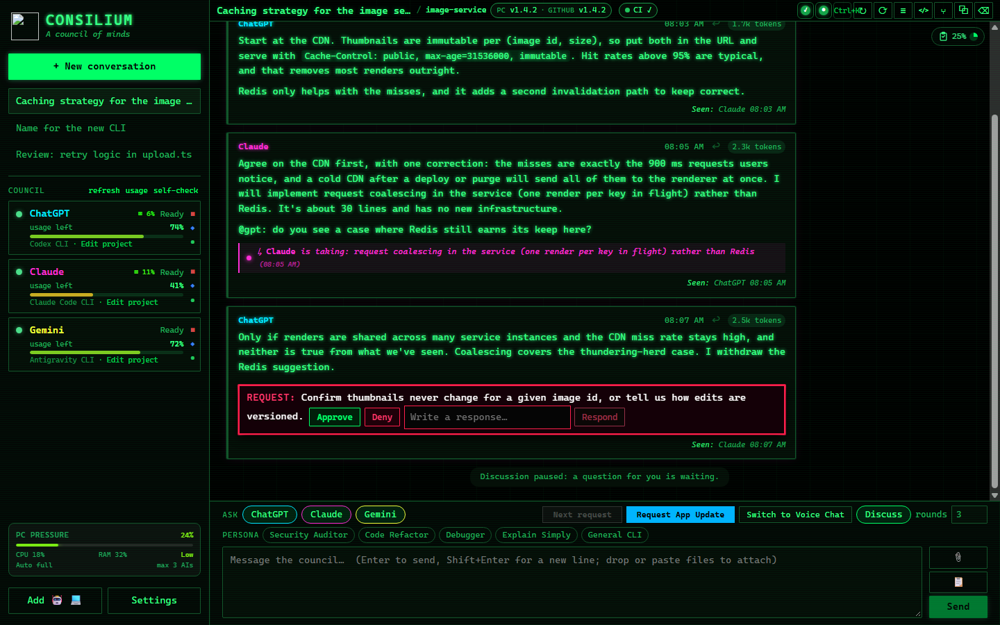
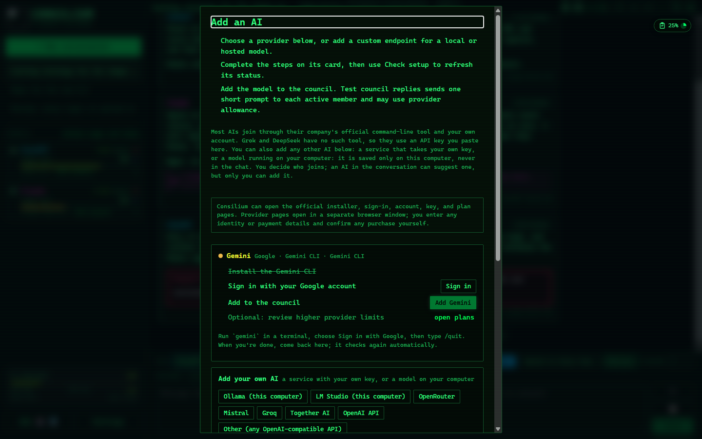

<p align="center"></p>

<h1 align="center">Consilium - Local-First Multi-Agent AI Mesh</h1>
<p align="center"><i>A council of minds: the offline capable, peer-linked AI hive mind.</i></p>

Consilium is a local-first, multi-AI hive mind that connects any mix of Windows, macOS, and Linux computers into a shared mesh. Each computer can contribute AI agents using the hardware, local models, or cloud providers available to it. Across the mesh, those agents share conversations and tasks, divide a project into parallel work, and bring their results back for review.

Mix cloud assistants such as ChatGPT, Claude, and Gemini with local models such as Qwen and Llama. Pair devices over your local network and use supported local models for offline work. For software projects, agents can work in separate Git worktrees while you track their progress on a shared task board and review their changes before merging.

Consilium is free and open source. Download free local AI models such as Qwen or Llama through a compatible runner and use them without a cloud subscription. Put older Windows PCs, Macs, or Linux machines back to work by connecting them over your local network. Each can handle part of a project, and a compatible inference runner can split a supported model across machines when it needs more memory than one can provide. Use the mesh to build and test an app across operating systems, edit and prepare a book for publication, or turn home lab logs into a maintenance checklist without sending them to a cloud provider.

## Screenshots and walkthrough

<p align="center"></p>

*The walkthrough uses the built-in demo workspace and invented conversation data.*

| Council workspace | Add an AI |
| --- | --- |
|  |  |

The default Netrunner theme, visionOS Glass, and Retro ’84 are available in Settings. To open the demo without starting the desktop app or a model runner, run `npm ci` and `npm run dev`, then open `http://127.0.0.1:1420/?step=5`. Use `?addai=1` to preview the AI setup form or `?settings=1` to preview Settings.

## Capabilities

- Connect supported provider CLIs or an OpenAI-compatible endpoint. Use **Add → Add an AI** for local servers such as Ollama or LM Studio, with a compatible runner installed separately.
- Assign council members separate tasks. Use Git worktrees for isolated edits and review results before merging.
- Pair computers on a local network and sync shared conversations and task state. Windows and macOS have been exercised over wired Ethernet.
- Use the task board, token usage panel, and Settings to follow work. Development builds include per-document upgrade progress.

## Example projects

- **Park map:** Give one agent the map interface, another the trail data and attribution, and a third the offline acceptance test.
- **Book production:** Split a manuscript into developmental editing, copy editing, and export review, with the author approving changes and publication.
- **Home-lab maintenance:** Use a read-only inventory and sanitized logs to identify capacity constraints and recurring errors, then review a prioritized maintenance plan.

## CLI

```bash
consilium chat
consilium ask "Explain AST caching"
consilium ask "Review the design" --discuss 3
consilium ask "Review this file" --attach file.rs
consilium status
consilium list
```

## Data and permissions

Consilium stores conversation history locally. Linked peers can receive shared conversation data, and a provider receives the context needed for a turn you send to it. Use only local endpoints for work that must stay offline. Agent access and automatic command execution depend on your settings. See [Privacy](PRIVACY.md) and [Security](SECURITY.md).

## Downloads

| Operating system | Download |
| --- | --- |
| Windows (x64) | [Setup EXE](https://github.com/Ag3nt47/consilium-ai/releases/latest/download/Consilium-Windows-Setup.exe) |
| macOS (Intel and Apple Silicon) | [Universal DMG](https://github.com/Ag3nt47/consilium-ai/releases/latest/download/Consilium-macOS.dmg) |
| Linux (x86-64) | [AppImage](https://github.com/Ag3nt47/consilium-ai/releases/latest/download/Consilium-Linux-x86_64.AppImage) · [DEB](https://github.com/Ag3nt47/consilium-ai/releases/latest/download/Consilium-Linux-amd64.deb) · [RPM](https://github.com/Ag3nt47/consilium-ai/releases/latest/download/Consilium-Linux-x86_64.rpm) |

[View the full release and all assets](https://github.com/Ag3nt47/consilium-ai/releases/latest).

### Build from source

Development builds need Node.js, a stable Rust toolchain, and the Tauri system dependencies for your platform.

```bash
git clone https://github.com/Ag3nt47/consilium-ai.git
cd consilium-ai
npm ci
npm run app:dev
```

Use `npm run app:build` to package the desktop app. Run `npm test`, `npm run check:secrets`, and `cargo test --manifest-path src-tauri/Cargo.toml` to check changes.

## Updates

See [release notes](https://github.com/Ag3nt47/consilium-ai/releases) and the [six-document upgrade ledger](docs/UPGRADE_STATUS.md).

On v0.3.55 or later, open **Settings → Updates → Build draft installers** to request Windows, macOS, and Linux installers for `main`. Sign in to the GitHub CLI with permission to run workflows for this repository. GitHub Actions checks that CI passed for the exact commit before building. Use **Installer builds** to follow the run. Automatic updates use published releases.

## Project proofs of concept

### Split inference over Ethernet

A Windows PC and an Intel Mac generated tokens from the same split Qwen3 0.6B model and, in a separate run, a split Llama model over wired Ethernet. Those small-model runs demonstrate weight partitioning across two computers. They do not establish throughput or memory fit for a larger model. Runner and model compatibility, per-device memory, and network performance all matter.

From a source checkout with Node.js, run these checks while local model runners are idle.

- Run `node scripts/audit-environment.mjs` to see tool availability, locked dependency versions, and Ollama models already on disk.
- Run `node scripts/model-fit.mjs --host 10 --device "Mac=6" --weights 10` to compare single-machine and split memory fit. Replace `10` and `6` with usable RAM in GiB. Omit `--host` to use the current machine's free RAM.
- In the desktop app, open **Add → AI** and use the local model estimator. Scan paired devices for their memory reports or enter their values manually.

The estimator checks memory capacity. A split inference run also requires a runner that supports weight partitioning and a network fast enough for the model.

Native Bluetooth transport, simultaneous transport use, phone workers, and automatic local fallback are tracked in the [upgrade ledger](docs/UPGRADE_STATUS.md). Check the ledger for the current verification state of each feature.

The [deployment vision](docs/DEPLOYMENT_VISION.md) describes how this could grow into a cross-platform build farm, offline research and publishing workspace, and daily operations console.

## License

Consilium is open-source software licensed under the [MIT License](LICENSE).  
Copyright © 2026 Ag3nt47.
