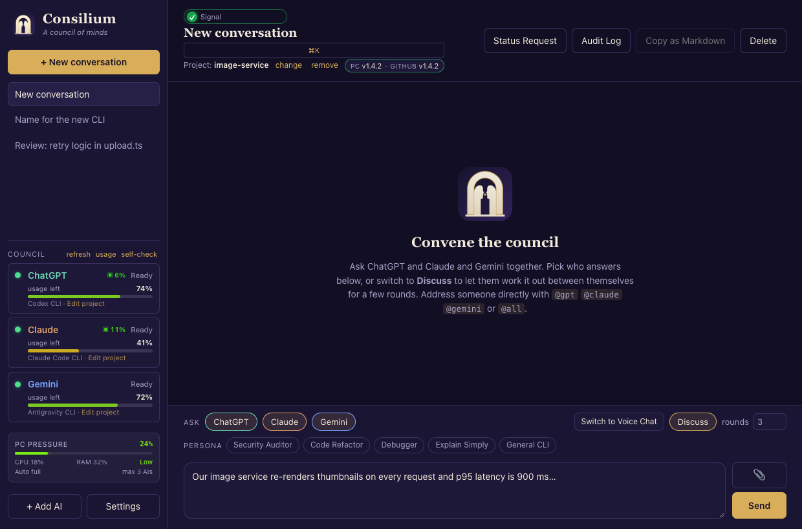
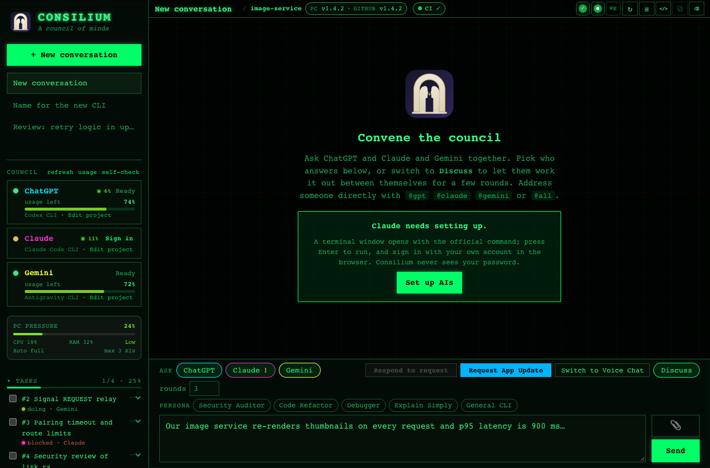
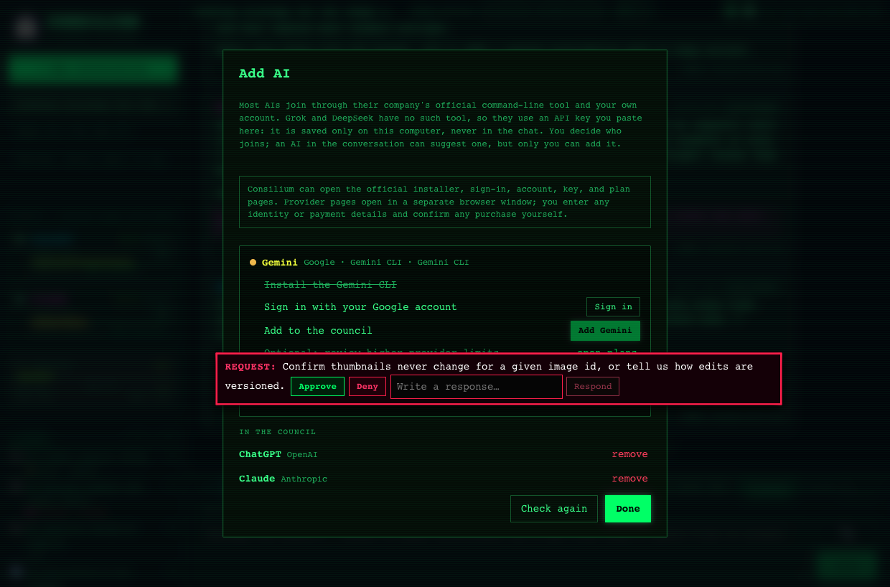
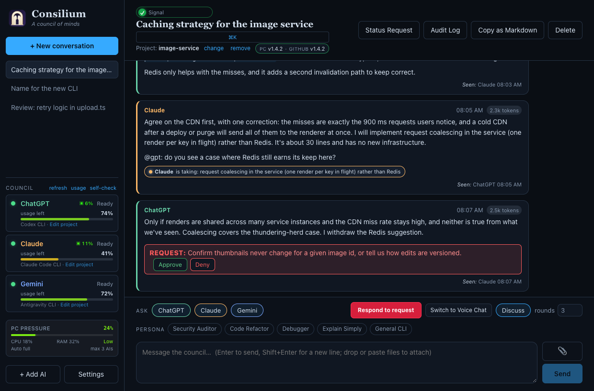

<p align="center"></p>

<h1 align="center">Consilium</h1>
<p align="center"><i>A council of minds.</i></p>

Consilium is a desktop app where several AI assistants and you work in one conversation. Ask ChatGPT and Claude the same question side by side, or let them **discuss** it between themselves for a few rounds while you watch, step in, or press Stop.

<p align="center"></p>
<p align="center"><sub>Demo with invented data.</sub></p>

- **No API keys for CLI agents.** ChatGPT takes part through OpenAI's Codex CLI, Claude through Anthropic's Claude Code CLI, and Gemini (optional, via **+ Add AI**) through Google's Antigravity CLI, each using your own existing sign-in. API-key agents (such as Grok via xAI and DeepSeek via API or local Ollama) store keys strictly on your local machine.
- **Voice Chat & Spoken Council.** Switch between text and voice conversation anytime ("Switch to Voice Chat"). AI replies are spoken aloud using distinct native macOS voices with markdown and code filtered out, and speech is transcribed into the shared transcript.
- **Interactive REQUEST Approve & Deny Buttons.** Every red `REQUEST:` callout includes inline **Approve** and **Deny** buttons. Decisions are dispatched immediately to the requesting AI, persist across app restarts, and prevent double submission.
- **The council can build.** Give a conversation a project folder and choose each AI's access: Chat only (default), Read, Edit, or Full (the permissions you already approved in its own app). With **Full capacity** on, every AI is Unrestricted in the project folder (it can run commands and install software without asking), works on what you ask, splits the work and reviews each other. An AI that @mentions another brings it into the turn. AIs can propose another participant with an `ADD_AI:` line; you approve every addition before its provider receives any transcript.
- **CLI Subprocess Stability & Prompt Interception.** Unbuffered execution streams ensure real-time token rendering. Watchdog monitors detect unexpected interactive terminal prompts (such as directory trust confirmations or password requests) and safely surface them as `REQUEST:` callouts instead of freezing.
- **Rotating Devil's Advocate.** In multi-round Discuss loops (round 3+), critical reviewer prompts break LLM polite agreement bias and force models to rigorously challenge each other's assumptions and code logic.
- **Real-Time Secret & Credential Redaction.** Automatic redaction scrubber filters API keys, GitHub tokens, JWTs, private keys, and environment variables from transcripts and persistent memory before disk writes.
- **visionOS Glassmorphic UI & Hover-to-Expand Controls.** Translucent frosted glass aesthetic (`backdrop-filter: blur(25px)`), ambient glow, hairline gradient borders, and minimal hover-to-expand secondary controls.
- **Spotlight Command Palette (Cmd+K / Ctrl+K).** Global keyboard-driven command palette for instant access to session actions, theme switching, diagnostic self-checks, and discussion controls.
- **Live Agent Activity & Health Indicators.** Pulsing cyan glow for active token generation, amber for deep compute/reasoning, and flashing red warning for stalled or frozen subprocesses.
- **Token Accounting & Usage Breakdown.** Granular per-turn token tracking (input, output, cache read/creation, thinking tokens) and daily totals.
- **Shared memory.** A council memory every AI keeps across conversations (AIs add to it with `REMEMBER:`), plus a project's `CONSILIUM.md` as shared project notes.
- **Picks up where it left off.** On macOS, closing the window keeps the AIs working in the background. If the app quits mid-turn, it resumes that turn on the next launch with git-aware diff context.
- **App or terminal, or both.** `consilium chat` talks to the same council in the same conversations from a terminal. Use either, or both at once: a message sent in one joins the AIs' turn in the other.
- **Usage at a glance, for you and the AIs.** Each AI's card shows its current model's allowance left with its whole plan underneath, and when each resets. Every AI is told where everyone stands, so they know when the others will be back.
- **Attach files.** Drop, paste or pick documents, Word files, pictures, PDFs and code (📎 in the message box, or `--attach` / `/attach` in the terminal). Every AI reads text and the text of Word, OpenDocument and PowerPoint files; ChatGPT and Claude look at pictures and PDFs.
- **One shared transcript**, color-coded by speaker. Anything an AI needs from you appears as a red **REQUEST:** callout.
- **Turn control.** *Ask* gets one answer from each AI you pick. *Discuss* lets them respond to each other for up to 8 rounds, and stops early when they're done or when one of them needs you. **Stop** ends it immediately.
- **Private by default.** Conversations stay on your computer. No telemetry. The only network calls Consilium itself makes are an optional once-a-day check for a new release on GitHub and, only if you turn it on, codex-reset.com's unofficial forecast of the next global Codex reset.
- **Themes:** Consilium (indigo, ivory and gold), visionOS Glass, Cyber, Slate, CRT, and *Retro '84* with neon grid and scanlines.

Runs on macOS, Windows and Linux.

| | |
| --- | --- |
|  |  |
| **Consilium** theme | **Retro '84** theme (neon grid, scanlines; effects can be turned off) |
|  |  |
| First run: **Set up AIs** | Settings: themes, AI access, Full capacity |
|  |  |
| **+ Add AI** | **Cyber** theme |

Screenshots use invented demo data. To see the UI in a browser without the app, run `npm run dev` and open `http://127.0.0.1:1420/?step=5` (`step` 0–5 walks through the demo; add `&theme=retro84`, `&settings=1` or `&setup=1`).

## Install

Download the installer for your system from [Releases](https://github.com/Ag3nt47/consilium-ai/releases), or use the one-line installer:

```bash
# macOS / Linux
curl -fsSL https://raw.githubusercontent.com/Ag3nt47/consilium-ai/main/install.sh | bash
```

```powershell
# Windows (PowerShell)
irm https://raw.githubusercontent.com/Ag3nt47/consilium-ai/main/install.ps1 | iex
```

The installers are not code-signed yet. On macOS the installer script removes the download quarantine for Consilium only; if you install the `.dmg` by hand, right-click the app and choose **Open** the first time. On Windows, choose **More info → Run anyway** in SmartScreen.

### First run

Consilium checks for both AI tools and shows a **Set up AIs** button for anything missing. It opens a terminal with the official install or sign-in command; press Enter, and sign in with your own account in the browser. You need at least one of:

| AI | Tool | Account |
| --- | --- | --- |
| ChatGPT | [Codex CLI](https://developers.openai.com/codex) (included in the ChatGPT desktop app on macOS) | ChatGPT plan |
| Claude | [Claude Code](https://claude.com/claude-code) | Claude plan |
| Gemini (optional) | [Antigravity CLI](https://antigravity.google/docs/getting-started/) (`agy`). Google stopped serving the Gemini CLI to personal accounts in June 2026; Consilium still uses it if `agy` isn't installed, for company plans and API keys. | Google account |
| Grok (optional) | xAI API connector (`api.x.ai`) | xAI API key (kept locally) |
| DeepSeek (optional) | DeepSeek API connector (`api.deepseek.com`) or local offline [Ollama](https://ollama.com) | DeepSeek API key or free offline Ollama |

Each AI's usage counts against your own plan with that provider.

## Terminal

The app is also a terminal command. Install it from **Settings → Terminal** (the install scripts do it for you), then:

```bash
consilium chat                      # talk with the council; /help lists the commands
consilium ask "Review my last commit" --to claude,gpt
consilium log -f                    # watch a conversation live
consilium list                      # conversations, newest first
consilium status                    # who's in the council, signed in, and usage left
```

It uses the same conversations, council, memory and settings as the app. Both can be open at once: the conversation's AIs run in one of them at a time, a message sent in the other joins that turn, and **Stop** works from either. `consilium help` shows every option.

## How it works

```
 You ─┐                      ┌─ Codex CLI (ChatGPT) ── your ChatGPT sign-in
      ├── Consilium core ────┤
      │   (Rust, event log)  └─ Claude Code CLI ───── your Claude sign-in
      └── React UI (Tauri)
```

Each AI turn starts the provider's CLI directly (never through a shell) and passes it the transcript. At the default *Chat only* access it runs in a fresh, empty temporary folder with its tools turned off, so it sees only the conversation. With higher access, in a conversation that has a project folder, it runs in that folder with the matching permissions (see [SECURITY.md](SECURITY.md)). Replies are read from the CLIs' documented machine-readable output. Stop, or a 15-minute limit, kills the CLI and everything it started.

Conversations are append-only logs in the app's data folder (`~/Library/Application Support/io.github.ag3nt47.consilium` on macOS, `%APPDATA%\io.github.ag3nt47.consilium` on Windows, `~/.local/share/io.github.ag3nt47.consilium` on Linux).

## Future Architecture & Capabilities

Consilium is evolving into an autonomous, multimodal local engineering environment. Key architectural phases on the roadmap include:
- **PC Resource Pressure Gauge (0–100%):** Real-time monitoring of host CPU and memory pressure with dynamic green-to-red color grading directly in the app header.
- **Git Worktree Concurrency Isolation:** Automatic isolated Git worktrees (`consilium/agent-task-<id>`) per agent during Full Capacity mode to prevent file clobbering.
- **Autonomous Night Shift Daemon:** Background scheduled jobs running dependency CVE auditing, tech debt sweeps, and unit-test validation in isolated staging branches.
- **Autonomous GitHub Tool & Skill Scraper:** Secure sandbox cloning, AST inspection, tool binding synthesis, and metadata-only public skill registry synchronization.
- **Local Offline Vector RAG:** Embedded local vector database (LanceDB / SQLite-VSS) for semantic codebase retrieval and past discussion memory.
- **Model Context Protocol (MCP) Integration:** Universal client layer connecting agents to local databases, dev tools, and containerized services.

## Build from source

Needs Node.js 20+, Rust, and on Linux the WebKitGTK libraries ([Tauri prerequisites](https://v2.tauri.app/start/prerequisites/)).

```bash
npm install
npm run app:dev      # run with live reload
npm run app:build    # build installers into src-tauri/target/release/bundle
```

Tests: `npm test` (privacy gate) and `cargo test` in `src-tauri`.

## Project layout

| Path | What |
| --- | --- |
| `src/` | React user interface |
| `src-tauri/src/` | Rust core: `store.rs` (event log), `agents.rs` (CLI adapters and access levels), `config.rs` (council members and access), `prompt.rs` (what each AI is told), `resume.rs` (continuing after a restart), `setup.rs` (Set up AIs), `lib.rs` (turn-taking) |
| `scripts/check-secrets.mjs` | Privacy gate: blocks keys, tokens and personal data from being committed |
| `self-improvement/` | How the AIs log issues and agree on patches, cheaply |
| `tools/doctor.mjs` | Agent Setup Kit: which AIs are installed and signed in, and the exact next step for any that aren't (`--json` for an AI to read) |
| `install.sh`, `install.ps1` | One-line installers |
| `docs/ROADMAP.md` | What's next, including voice mode and mobile |

## Security and privacy

See [SECURITY.md](SECURITY.md) and [PRIVACY.md](PRIVACY.md). Report vulnerabilities privately through GitHub's **Report a vulnerability** button on the Security tab.

## License

MIT; see [LICENSE](LICENSE). Visual design values for the Cyber, Slate and CRT themes come from the [UI Design Bundle](https://github.com/Ag3nt47/UI-Design-Bundle); see [THIRD_PARTY_NOTICES.md](THIRD_PARTY_NOTICES.md). Consilium is an independent project, not affiliated with OpenAI or Anthropic. ChatGPT, Codex, Claude and Claude Code are trademarks of their owners.
