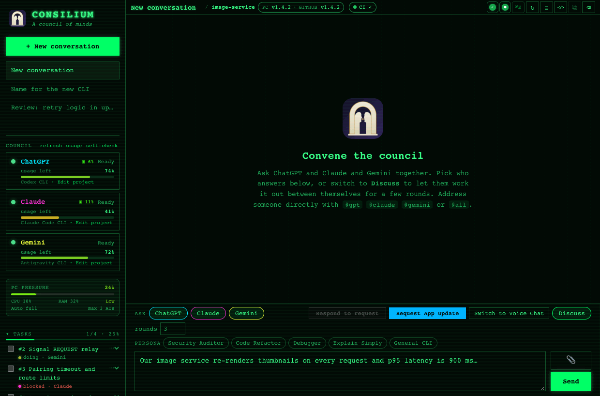
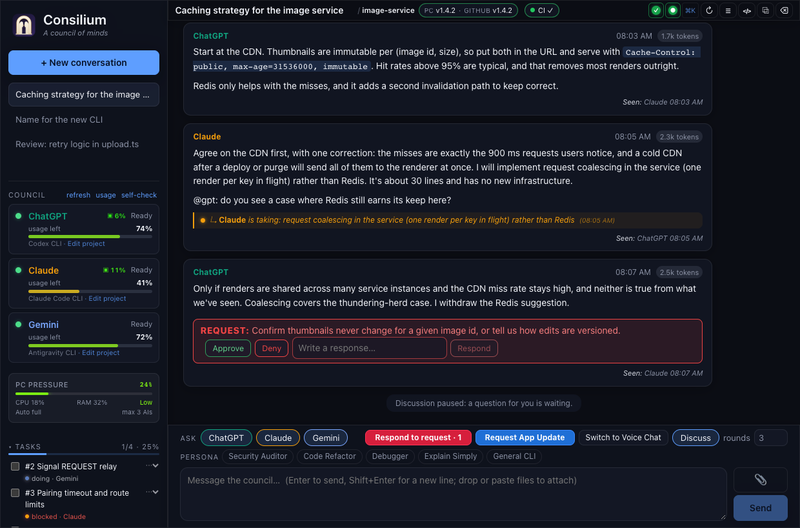
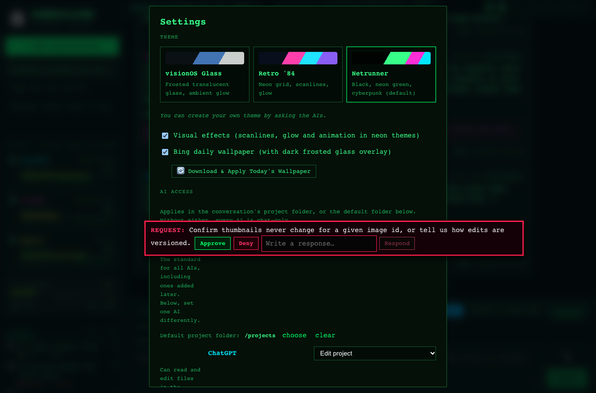

<p align="center"></p>

<h1 align="center">Consilium</h1>
<p align="center"><i>A council of minds.</i></p>

Consilium is a desktop app where several AI assistants and you work in one conversation. Ask ChatGPT, Claude, Gemini, Grok or DeepSeek the same question side by side, or let them **discuss** it between themselves for a few rounds while you watch, step in, or press Stop.

## Why use the hive mind?

A single AI can give a fast answer; a council can expose blind spots. Consilium brings independent models into one shared workspace so they can compare approaches, challenge weak assumptions, divide project work and review one another before you act. You stay in control through explicit approvals, access levels and Stop controls, while the shared transcript remains on your computer.

Download Consilium if you want more than several disconnected chatbot tabs: one place to ask for competing opinions, reach a better-supported decision, or have a supervised AI team help research, code and troubleshoot with a visible record of who did what.

<p align="center"></p>
<p align="center"><sub>Demo with invented data.</sub></p>

- **Existing sign-ins for CLI agents.** ChatGPT takes part through OpenAI's Codex CLI, Claude through Anthropic's Claude Code CLI, and Gemini through Google's Antigravity CLI. Optional Grok and DeepSeek connectors use API keys stored only in the app's local data folder (mode `0600` on Unix) or their standard environment variables; keys are never put into the transcript or returned to the UI.
- **Voice Chat & Spoken Council.** Switch between text and voice conversation anytime. AI replies are read through the system speech service with markdown and code filtered out, and supported WebKit speech recognition sends transcribed messages into the shared transcript. macOS Dictation is the fallback when recognition is unavailable in the app window.
- **Interactive REQUEST Approve & Deny Buttons.** Every red `REQUEST:` callout includes inline **Approve** and **Deny** buttons. Decisions are dispatched immediately to the requesting AI, persist across app restarts, and prevent double submission.
- **Approval-gated AI onboarding.** An AI can propose `ADD_AI: <name>`; one click starts the correct official installer, sign-in, or API-console path. Account and plan pages open in the browser, but Consilium never fills identity or payment fields or confirms a purchase. The human still approves transcript sharing before the new AI joins.
- **The council can build.** Give a conversation a project folder and choose each AI's access: Chat only (default), Read, Edit, or Full (the permissions you already approved in its own app). With **Full capacity** on, every AI is Unrestricted in the project folder (it can run commands and install software without asking), works on what you ask, splits the work and reviews each other. An AI that @mentions another brings it into the turn. AIs can propose another participant with an `ADD_AI:` line; you approve every addition before its provider receives any transcript.
- **CLI Subprocess Stability & Prompt Interception.** Provider output pipes are drained as data arrives and common runtime buffering is disabled. A watchdog detects unexpected interactive terminal prompts (such as directory trust confirmations or password requests) and surfaces them as `REQUEST:` callouts instead of freezing.
- **Rotating Devil's Advocate.** In multi-round Discuss loops (round 3+), critical reviewer prompts break LLM polite agreement bias and force models to rigorously challenge each other's assumptions and code logic.
- **Real-Time Secret & Credential Redaction.** Automatic redaction scrubber filters API keys, GitHub tokens, JWTs, private keys, and environment variables from transcripts and persistent memory before disk writes.
- **visionOS Glassmorphic UI & Hover-to-Expand Controls.** Translucent frosted glass aesthetic (`backdrop-filter: blur(25px)`), ambient glow, hairline gradient borders, and minimal hover-to-expand secondary controls.
- **Spotlight Command Palette (Cmd+K / Ctrl+K).** Global keyboard-driven command palette for instant access to session actions, theme switching, diagnostic self-checks, and discussion controls.
- **Native Agent Activity & Health Indicators.** Live provider telemetry says when each AI is planning, reading, researching, editing, running a command, using a tool, delegating, or writing its report. Details come from each CLI's structured events; private chain-of-thought is never requested or shown. A red warning appears only when output is silent *and* the AI process has no measurable CPU or memory activity.
- **Status Request.** One button asks every council member for a concise, independent report of completed work, current work, blockers, uncommitted changes and its next step. It also appears in the command palette.
- **PC pressure at a glance.** A two-second cross-platform sampler shows total CPU and memory pressure from green to red, plus the share used by each active CLI agent next to its name.
- **Fast, resumable updates on macOS, Windows and Linux.** A locally staged build (`npm run update:stage`) appears as **Update Now** beside the prompt. One click tells active AIs to hold, swaps the app atomically, reopens the conversation and resumes interrupted turns from the on-disk worktree.
- **Window-aware layout and hover help.** Controls, messages, modals and status cards wrap or scroll cleanly down to the supported 760×520 window. Hovering a control or meter gives a short explanation without leaving the conversation.
- **Token Accounting & Usage Breakdown.** Granular per-turn token tracking (input, output, cache read/creation, thinking tokens) and daily totals.
- **Shared memory.** A council memory every AI keeps across conversations (AIs add to it with `REMEMBER:`), plus a project's `CONSILIUM.md` as shared project notes.
- **Picks up where it left off.** On macOS, closing the window keeps the AIs working in the background. If the app quits mid-turn, it resumes that turn on the next launch and tells an interrupted coding agent to inspect `git status` and `git diff` before continuing.
- **App or terminal, or both.** `consilium chat` talks to the same council in the same conversations from a terminal. Use either, or both at once: a message sent in one joins the AIs' turn in the other.
- **Usage at a glance, for you and the AIs.** Each AI's card shows its current model's allowance left with its whole plan underneath, and when each resets. Every AI is told where everyone stands, so they know when the others will be back.
- **Attach files.** Drop, paste or pick documents, Word files, pictures, PDFs and code (📎 in the message box, or `--attach` / `/attach` in the terminal). Every AI reads text and the text of Word, OpenDocument and PowerPoint files; ChatGPT and Claude look at pictures and PDFs.
- **One shared transcript**, color-coded by speaker. Anything an AI needs from you appears as a red **REQUEST:** callout with **Approve** and **Deny** actions.
- **Turn control.** *Ask* gets one answer from each AI you pick. *Discuss* lets them respond to each other for up to 8 rounds, and stops early when they're done or when one of them needs you. **Stop** ends it immediately.
- **Private by default.** Conversations stay on your computer and Consilium has no telemetry. Turns go only to the providers you add; optional network calls are the daily GitHub release check and, when enabled, codex-reset.com's unofficial reset forecast.
- **Themes:** Consilium (indigo, ivory and gold), visionOS Glass, Cyber, Slate, CRT, *Retro '84* with neon grid and scanlines, and *Netrunner* cyberpunk black & neon green.

Runs on macOS, Windows and Linux.

| | |
| --- | --- |
|  |  |
| **visionOS Glass** theme (title bar icons, CI light, task checklist, Seen receipts) | **Netrunner** cyberpunk theme (crisp REQUEST callouts, typewriter effects) |
|  |  |
| **Voice Chat** & dual audio visualizers | **Retro '84** theme (neon grid, scanlines; effects can be turned off) |
|  |  |
| First run: **Set up AIs** | Settings: themes, Signal messaging, Bing wallpaper |
|  | |
| **+ Add AI** | |

Screenshots use invented demo data. To see the UI in a browser without the app, run `npm run dev` and open `http://127.0.0.1:1420/?step=5` (`step` 0–5 walks through the demo; add `&theme=netrunner`, `&theme=retro84`, `&voice=1`, `&settings=1` or `&setup=1`).

## Install

**One-click download** of the newest version:

| System | Download | Then |
| --- | --- | --- |
| macOS (Apple silicon and Intel) | [**Consilium-macOS.dmg**](https://github.com/Ag3nt47/consilium-ai/releases/latest/download/Consilium-macOS.dmg) | Open it and drag Consilium to Applications |
| Windows 10/11 | [**Consilium-Windows-Setup.exe**](https://github.com/Ag3nt47/consilium-ai/releases/latest/download/Consilium-Windows-Setup.exe) | Run it; no admin rights needed |
| Linux (Ubuntu/Debian) | [**Consilium-Linux-amd64.deb**](https://github.com/Ag3nt47/consilium-ai/releases/latest/download/Consilium-Linux-amd64.deb) | Double-click to install |
| Linux (any) | [**Consilium-Linux-x86_64.AppImage**](https://github.com/Ag3nt47/consilium-ai/releases/latest/download/Consilium-Linux-x86_64.AppImage) | Mark it executable and run it |

Every version is also on [Releases](https://github.com/Ag3nt47/consilium-ai/releases). Or use the one-line installer, which also sets up the `consilium` terminal command:

```bash
# macOS / Linux
curl -fsSL https://raw.githubusercontent.com/Ag3nt47/consilium-ai/main/install.sh | bash
```

```powershell
# Windows (PowerShell)
irm https://raw.githubusercontent.com/Ag3nt47/consilium-ai/main/install.ps1 | iex
```

The installers are not code-signed yet. On macOS the installer script removes the download quarantine for Consilium only; if you install the `.dmg` by hand, right-click the app and choose **Open** the first time. On Windows, choose **More info → Run anyway** in SmartScreen.

### First run

Consilium checks for both AI tools and shows a **Set up AIs** button for anything missing. It opens a terminal with the official install or sign-in command; press Enter, and sign in with your own account in the browser. You need at least one of:

| AI | Tool | Account |
| --- | --- | --- |
| ChatGPT | [Codex CLI](https://developers.openai.com/codex) (included in the ChatGPT desktop app on macOS) | ChatGPT plan |
| Claude | [Claude Code](https://claude.com/claude-code) | Claude plan |
| Gemini (optional) | [Antigravity CLI](https://antigravity.google/docs/getting-started/) (`agy`). Google stopped serving the Gemini CLI to personal accounts in June 2026; Consilium still uses it if `agy` isn't installed, for company plans and API keys. | Google account |
| Grok (optional) | xAI API connector (`api.x.ai`) | xAI API key (kept locally) |
| DeepSeek (optional) | DeepSeek API connector (`api.deepseek.com`) | DeepSeek API key (kept locally) |

Each AI's usage counts against your own plan with that provider.

## Terminal

The app is also a terminal command. Install it from **Settings → Terminal** (the install scripts do it for you), then:

```bash
consilium chat                      # talk with the council; /help lists the commands
consilium ask "Review my last commit" --to claude,gpt
consilium log -f                    # watch a conversation live
consilium list                      # conversations, newest first
consilium status                    # who's in the council, signed in, and usage left
```

It uses the same conversations, council, memory and settings as the app. Both can be open at once: the conversation's AIs run in one of them at a time, a message sent in the other joins that turn, and **Stop** works from either. `consilium help` shows every option.

## How it works

```
 You ─┐                      ┌─ Codex CLI (ChatGPT) ──── your ChatGPT sign-in
      ├── Consilium core ────┼─ Claude Code CLI ─────── your Claude sign-in
      │   (Rust, event log)  ├─ Antigravity (Gemini) ── your Google sign-in
      └── React UI (Tauri)   └─ xAI / DeepSeek APIs ─── your optional local keys
```

For CLI agents, each turn starts the provider's program directly (never through a shell) and passes it the transcript. At the default *Chat only* access it runs in a fresh, empty temporary folder with tools turned off. With higher access and a project folder, it runs there with the selected permissions (see [SECURITY.md](SECURITY.md)). Grok and DeepSeek use their providers' OpenAI-compatible HTTPS APIs and always remain chat-only. Replies and token counts come from documented machine-readable output. Stop cancels the turn; CLI turns also have a 15-minute limit and process-tree cleanup.

Conversations are append-only logs in the app's data folder (`~/Library/Application Support/io.github.ag3nt47.consilium` on macOS, `%APPDATA%\io.github.ag3nt47.consilium` on Windows, `~/.local/share/io.github.ag3nt47.consilium` on Linux).

## Future Architecture & Capabilities

The next releases focus on safe foundations before unattended autonomy:

- **Ground-truth context:** inject a bounded git status/diff summary into coding turns and compact old transcript context without hiding current decisions.
- **Concurrency isolation:** create one git worktree and task branch per editing agent, with validation gates before changes return to the main checkout.
- **Deeper observable execution:** retain the new native activity strip while adding a terminal drawer, prompt-wait recovery controls and a bounded per-turn action timeline.
- **Multimodal workflows:** strengthen document/image ingestion and add explicit `/deconstruct` and `/reassemble` pipelines.
- **Extensible tools:** add sandboxed GitHub repository inspection, MCP clients, local/OpenAI-compatible models and a private skill registry before any public metadata sync.
- **Supervised automation:** nightly audits and maintenance branches with budgets, test gates and human review—never unattended merges or host-level changes.

See the ordered, constraint-aware [roadmap](docs/ROADMAP.md) for the full plan and the capabilities intentionally deferred as infeasible or unsafe.

## Build from source

Needs Node.js 20+, Rust, and on Linux the WebKitGTK libraries ([Tauri prerequisites](https://v2.tauri.app/start/prerequisites/)).

```bash
npm install
npm run app:dev      # run with live reload
npm run app:build    # build installers into src-tauri/target/release/bundle
npm run clean        # clean temporary staging workspaces, logs, and build artifacts
```

Checks: `npm run build`, `npm test`, `node scripts/check-secrets.mjs`, plus `cargo test` and `cargo clippy --all-targets -- -D warnings` in `src-tauri`. Use `npm run clean:all` to also reclaim the Rust target cache.

## Project layout

| Path | What |
| --- | --- |
| `src/` | React user interface |
| `src-tauri/src/` | Rust core: `engine.rs`/`council.rs` (turn-taking), `store.rs` (event log), `agents.rs` and `apiagent.rs` (provider adapters), `attach.rs` (ingestion), `prompt.rs` (AI context), `resume.rs` (restart recovery) |
| `scripts/check-secrets.mjs` | Privacy gate: blocks keys, tokens and personal data from being committed |
| `self-improvement/` | How the AIs log issues and agree on patches, cheaply |
| `tools/doctor.mjs` | Agent Setup Kit: which AIs are installed and signed in, and the exact next step for any that aren't (`--json` for an AI to read) |
| `install.sh`, `install.ps1` | One-line installers |
| `docs/ROADMAP.md` | Shipped foundations, ordered next steps, safety gates and long-term research |

## Security and privacy

See [SECURITY.md](SECURITY.md) and [PRIVACY.md](PRIVACY.md). Report vulnerabilities privately through GitHub's **Report a vulnerability** button on the Security tab.

## License

MIT; see [LICENSE](LICENSE). Visual design values for the Cyber, Slate and CRT themes come from the [UI Design Bundle](https://github.com/Ag3nt47/UI-Design-Bundle); see [THIRD_PARTY_NOTICES.md](THIRD_PARTY_NOTICES.md). Consilium is an independent project, not affiliated with OpenAI or Anthropic. ChatGPT, Codex, Claude and Claude Code are trademarks of their owners.
