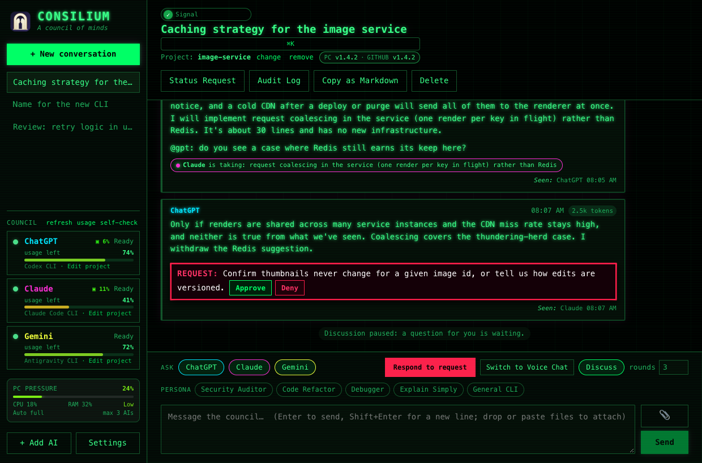
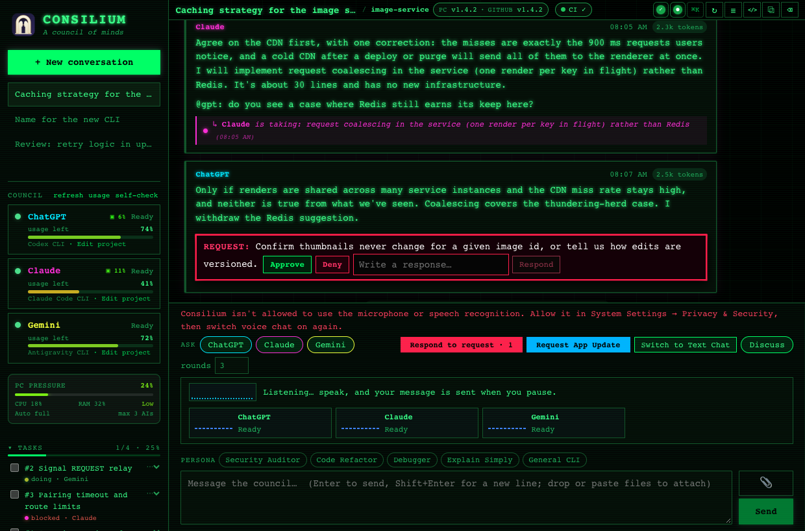
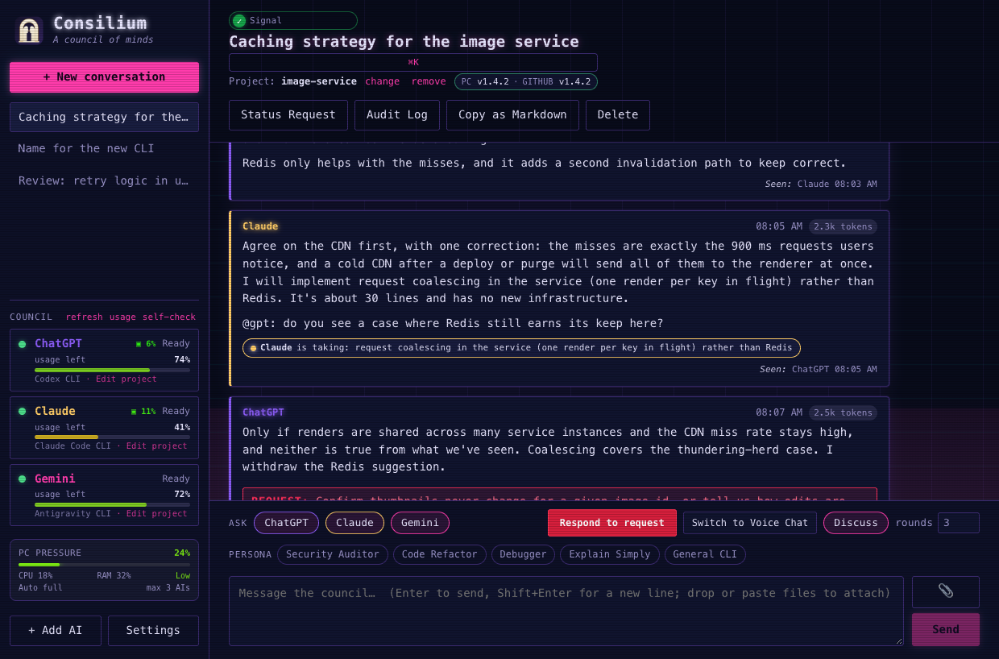

<p align="center"></p>

<h1 align="center">Consilium - Local-First Multi-Agent AI Mesh</h1>
<p align="center"><i>A council of minds: the offline-first, peer-linked AI hive mind.</i></p>

Consilium is an elite, cross-platform desktop application and command-line environment that transforms your local hardware network into an autonomous Hive Mind home server. Effortlessly link any mix of computers running Windows, macOS, or Linux into a seamless, offline LAN cluster where each node hosts its own dedicated AI instances—uniting heavyweights like ChatGPT, Claude, Gemini, Grok, and DeepSeek alongside local powerhouses like Llama 3, Qwen 2.5 Coder, and DeepSeek-R1—to tackle massive, complex projects faster than ever, entirely on your own terms and with the capablity for complete air-gap from the cloud.

<p align="center"></p>
<p align="center"><sub>Interactive multi-agent council in Discuss mode: real-time peer debate, automated cross-examination, and human-in-the-loop approvals.</sub></p>

| | |
| --- | --- |
|  |  |
| **visionOS Glass** theme (title bar icons, CI light, task checklist, Seen receipts) | **Netrunner** cyberpunk theme (crisp REQUEST callouts, typewriter effects) |
|  |  |
| **Voice Chat** & dual audio visualizers | **Retro '84** theme (neon grid, scanlines; effects can be turned off) |
|  |  |
| First run: **Set up AIs** (zero-config CLI agent discovery) | Settings: themes, Signal messaging, Bing wallpaper |
|  | |
| **+ Add AI** (dynamic local & cloud model onboarding) | |

<sub>Screenshots use invented demo data. To see the UI in a browser without the app, run `npm run dev` and open `http://127.0.0.1:1420/?step=5` (`step` 0–5 walks through the demo; add `&theme=netrunner`, `&theme=retro84`, `&voice=1`, `&settings=1` or `&setup=1`).</sub>

---

## Why Use the Hive Mind?

A single AI model—no matter how capable—suffers from inherent blind spots, sycophancy, dataset bias, hallucination loops, and context degradation. Consilium replaces isolated single-model chatbots with a resilient, dialectical collective intelligence.

### 1. Collective Intelligence vs. Single-Model Bias
- **Hypothesis Cross-Examination:** One model proposes an architecture; competing models immediately audit it for edge cases, security vulnerabilities, race conditions, and performance bottlenecks.
- **Rotating Devil's Advocate:** Starting in round 3 of multi-round Discuss loops, Consilium automatically assigns a rotating reviewer role to break LLM polite agreement bias, forcing models to challenge lazy consensus and stress-test assumptions.
- **Dialectical Synthesis:** Disagreements are resolved through evidence, benchmark reproduction, and unit tests rather than speculative debate.

### 2. Heterogeneous Cognitive Specialization
Different model architectures possess distinct cognitive topologies, training methodologies, and specialized strengths. Consilium routes tasks to match these competencies:
- **Claude (Anthropic):** Exceptional systemic architecture design, safety-critical code refactoring, rigorous verification, and clean documentation.
- **ChatGPT / Codex (OpenAI):** Rapid algorithm generation, versatile API integrations, broad tool execution, and flexible script synthesis.
- **Gemini (Google):** Massive multi-million token context ingestion, whole-codebase comprehension, multi-file synthesis, and multimodal analysis.
- **DeepSeek-R1 (DeepSeek):** Deep chain-of-thought mathematical proofing, formal logic deduction, and complex algorithmic derivation.
- **Qwen 2.5 Coder & Llama 3 (Alibaba & Meta):** High-speed, syntactically strict, offline-native code generation and refactoring with zero API cost and zero telemetry.

### 3. Absolute Human Sovereignty
The human is never bypassed. High-stakes actions, external tools, software installations, and destructive file modifications are intercepted and surfaced as high-visibility red **`REQUEST:`** callouts with one-click in-chat **Approve** and **Deny** buttons.

---

## Intelligent AI Tiering: Paid Cloud & Offline Local Fallback

Consilium solves the disruptive problem of cloud API rate limits, hourly cooldowns, and exhausted plan quotas through an intelligent, multi-tier scheduling hierarchy.

```
┌────────────────────────────────────────────────────────────────────────┐
│                        TIER 1: FLAGSHIP CLOUD                          │
│        Claude 3.5 / Opus  •  GPT-4o / Codex  •  Gemini Pro / Flash      │
│     (Leads architecture, strategic planning, and complex authoring)     │
└───────────────────────────────────┬────────────────────────────────────┘
                                    │
                         Quotas Exhausted / 0%?
                                    │
                                    ▼
┌────────────────────────────────────────────────────────────────────────┐
│                    TIER 2: LOCAL OFFLINE FALLBACK                      │
│       Qwen 2.5 Coder (3B/7B)  •  Llama 3 (8B)  •  DeepSeek-R1 (8B)      │
│         (Runs locally via Ollama / llama.cpp — zero internet)          │
└────────────────────────────────────────────────────────────────────────┘
```

1. **Flagship Cloud Priority:** While provider plan allowances (Claude, GPT, Gemini) remain above 0%, flagship models lead council turns, formulate plans, and draft implementations.
2. **Silent Local Standby:** High-performance local models (Llama 3, Qwen 2.5 Coder, DeepSeek-R1-8B) remain hosted on local inference engines (`Ollama` or `llama.cpp` `llama-server`) in silent standby during automated rounds.
3. **Seamless Autonomous Handover:** The instant a flagship model exhausts its allowance or encounters provider rate limits, Consilium automatically promotes local models into the active turn rotation. Ongoing builds, code generation, and test suites continue uninterrupted without human downtime.
4. **Direct Mention Bypass:** Any participant can explicitly summon any local model at any time (e.g. `@qwen`, `@llama`, `@deepseekr18b`), immediately engaging local models for targeted, private, zero-token-cost tasks regardless of cloud quota status.

---

## Dynamic Swarms: Adding, Mentoring, and Spawning AI Workers

Consilium is not limited to a static list of models. It functions as an extensible agency where models train, assist, and scale one another dynamically.

```
┌────────────────────────────────────────────────────────────────────────┐
│                        COUNCIL OF MINDS (CORE)                         │
│               Claude  •  GPT-4o  •  Gemini  •  DeepSeek                │
└───────────────────────────────────┬────────────────────────────────────┘
                                    │ Mentoring, Test Suites & Delegation
                                    ▼
┌────────────────────────────────────────────────────────────────────────┐
│                   PEER COACHING & DYNAMIC SWARMS                       │
│  ┌──────────────────────────┐         ┌─────────────────────────────┐  │
│  │   TRAIN & GUIDE PEERS    │         │     SPAWN WORKER BOTS       │  │
│  │  • Formulate test specs  │         │  • Shard multi-file edits   │  │
│  │  • Debug compile errors  │         │  • Isolated git worktrees   │  │
│  │  • Coach local 3B/8B AIs │         │  • Parallel bug sweeps      │  │
│  └──────────────────────────┘         └─────────────────────────────┘  │
│                                   │                                    │
│                                   ▼                                    │
│  ┌──────────────────────────────────────────────────────────────────┐  │
│  │                     EXTENSIBLE SKILLSETS                         │  │
│  │  Reverse Engineering (REA) • Zero Breach Security • AnonRouter   │  │
│  │  Ghidra Native Decompilation • JADX Android • Playwright Browser │  │
│  └──────────────────────────────────────────────────────────────────┘  │
└────────────────────────────────────────────────────────────────────────┘
```

### 1. Seamless Model Onboarding (`ADD_AI` & Open Standards)
- **Universal Endpoint Support:** Connect any model running locally via Ollama, LM Studio, vLLM, or llama.cpp, as well as cloud endpoints from OpenAI, Anthropic, Google, xAI, Groq, Mistral, and OpenRouter.
- **Dynamic In-Chat Addition:** Any participant can introduce new models on the fly with declarative `ADD_AI: <name>` directives. The user approves the addition and connects credentials with a single click.

### 2. Peer Mentoring: Training & Helping Smaller Models
- **Frontier AI as Force Multiplier:** Frontier flagship models (Claude 3.5, GPT-4o, Gemini Pro) act as technical leads and mentors to smaller, highly-efficient local models (Llama 3, Qwen 2.5 Coder, DeepSeek-R1-8B).
- **Test-Driven Scaffolding:** Senior models write strict unit tests and boundary assertions before delegating execution to local coding models, providing a tight automated feedback loop.
- **Error Coaching & Root Cause Debugging:** When a local model encounters syntax errors or compiler diagnostic warnings, senior models analyze the compiler trace, explain the root cause, and coach the local model on the exact patch pattern.

### 3. Dynamic Worker Bot Spawning
- **Autonomous Swarm Scaling:** When confronting large-scale refactoring passes, multi-module migrations, or deep security audits, the council can spawn transient worker bots.
- **Per-Bot Worktree Isolation:** Spawned workers execute in isolated git worktrees (`consilium-<feature> -b ai/<worker>/<task>`), ensuring independent builds, private compiler caches, and zero file collision with the primary workspace.
- **Unified Board Coordination:** All spawned workers report status to the central distributed task board (`TASK: take/done/blocked/hand`), keeping the human and other AIs aware of parallel progress.

### 4. Modular Skillsets & Granular Access Control
- **Domain-Specific Tooling:** Equip any model or spawned bot with specialized capabilities:
  - **Reverse Engineering & Binary Analysis:** Native reverse-engineering via REA, Ghidra headless decompilation, and JADX APK decompilation.
  - **Security & Integrity Auditing:** Offline compromise and spyware scanning with Zero Breach Toolkit.
  - **Confidential AI Routing:** Zero-data-retention network routing via AnonRouter.
  - **Browser & Web Automation:** Headless scenario capture, DOM tree evaluation, and network waterfall analysis.
- **Least-Privilege Guardrails:** Assign strict per-AI permission levels (Chat, Read, Edit, Own, Full) ensuring external models and auxiliary workers only operate within their authorized boundaries.

---

## PeerLink: Offline Multi-Workstation Mesh Network

Consilium links multiple physical computers—such as a macOS developer laptop and a high-powered Windows or Linux workstation—into a synchronized, multi-node hive mind that works **completely offline without requiring an internet connection**.

```
   ┌───────────────────────┐                     ┌───────────────────────┐
   │       Lukes-MBP       │                     │      MSI-AGENT47      │
   │    (macOS / Client)   │◄─── PeerLink ──────►│  (Windows / Compute)  │
   │   • Qwen 2.5 Coder    │     ChaCha20-       │   • Llama 3 (8B)      │
   │   • DeepSeek-R1 (8B)  │     Poly1305        │   • DeepSeek-R1 (8B)  │
   │   • Primary Releaser  │     SPAKE2 Auth     │   • High-Cap Drives   │
   └───────────┬───────────┘                     └───────────┬───────────┘
               │                                             │
               └─── Multi-Route Race: Ethernet • Wi-Fi ──────┘
                    Link-Local Cable (169.254.x.x) • BLE
```

### Zero-Internet Physical Mesh Transports
- **Direct Ethernet Cable:** Connect two machines directly with a standard Ethernet cable using link-local IPv4 autoconfiguration (`169.254.x.x`) without a router, DHCP server, or switch.
- **Local Ad-Hoc Wi-Fi:** Communicate across an air-gapped local Wi-Fi router or peer-to-peer ad-hoc network with zero external WAN connectivity.
- **Thunderbolt & USB Bridges:** High-throughput sub-millisecond local interconnects.
- **Bluetooth BLE / RFCOMM Fallback:** Low-power out-of-band message framing and heartbeat monitoring when physical networking is detached.
- **Encrypted Virtual Mesh:** Seamless integration over Tailscale or WireGuard overlays when collaborating remotely across networks.

### Sub-Second Route Racing & Seamless Failover
- **Dynamic Address Exchange:** Nodes discover and continuously broadcast all candidate network interfaces (`local_addrs`).
- **Parallel Channel Racing:** Messages and heartbeats are raced concurrently across all live interfaces (LAN, Wi-Fi, direct cable).
- **Fast Dead-Route Tripwire:** Operates with a 1.5-second heartbeat and a strict 4-second silence tripwire. If an Ethernet cable is unplugged mid-sentence, PeerLink seamlessly and transparently diverts transport to Wi-Fi or Bluetooth without dropping, corrupting, or duplicating a single packet.

### Hardened Cryptography & Resilient Synchronization
- **SPAKE2 Pairing:** One-time 6-digit numeric pairing code verified through SPAKE2 password-authenticated key exchange, preventing offline dictionary attacks.
- **ChaCha20-Poly1305 Framing:** Every TCP packet is framed with AEAD encryption and verified with HMAC authentication; private keys are stored with restricted permissions (`0600` on Unix).
- **Transactional Dedup Ledger (`sync_ledger`):** A strict four-stage pipeline (*Reserve* → *Durable Inbox* → *Commit* → *Acknowledge*) guarantees that packets survive unexpected OS crashes, power cuts, or process restarts.
- **Synchronized Distributed Task Board:** A single shared task board tracks ownership (`TASK: take/done/blocked/hand/add/drop`), ensuring AIs across different machines never duplicate effort.
- **Remote Watchdog Daemon:** Paired machines monitor each other's status and can issue authenticated cryptographic relaunch requests to restart Consilium instances if a host freezes.

---

## Canonical Feature Ledger (All 4 Upgrade Blueprints)

Consilium's development directly implements the scope established across the four canonical upgrade documents. The matrix below details all current and scheduled capabilities.

### Document 1: Master Upgrade Blueprint (27 Phases)

| Phase & Capability | Status | Implementation Details |
|---|---|---|
| **Phase 1: Interactive Prompt Interception** | ✅ Built | Subprocess stdin/stdout streams monitored in real time; terminal prompts (directory trust, auth) converted to red in-chat `REQUEST:` callouts. |
| **Phase 2: Unbuffered Streaming Engine** | ✅ Built | Direct IPC streaming with line-by-line JSON parsing; standard terminal pipe buffering disabled across all CLI adapters. |
| **Phase 3: Pre-Flight Auth Verification** | ✅ Built | Non-intrusive CLI checks verify existing user credentials before task allocation without consuming model tokens. |
| **Phase 4: Universal AI Model Registry** | ✅ Built | Plug-and-play support for custom OpenAI-compatible endpoints (OpenRouter, Mistral, Groq, Together, Ollama, LM Studio, llama.cpp). |
| **Phase 5: Rotating Devil's Advocate** | ✅ Built | Multi-round Discuss loops automatically introduce a rotating critical reviewer to challenge weak consensus and surface latent flaws. |
| **Phase 6: Context Sliding Window** | ✅ Built | Prompts exceeding 120,000 characters trigger bounded local digestion, preserving 104,000 characters of verbatim context plus an intent/decision ledger. |
| **Phase 7: File-State Hashing & Git Diffs** | ✅ Built | Incremental file-tree state hashing with bounded git diff injection before every editing turn. |
| **Phase 8: Destructive Command Sanitizer** | ✅ Built | Pre-execution pattern matching detects catastrophic disk, system, or recursive deletion commands and forces an explicit human `REQUEST:`. |
| **Phase 9: Real-Time Secret Redaction** | ✅ Built | In-memory token scanner redacts API keys, bearer tokens, private keys, and environment secrets prior to transcript persistence. |
| **Phase 10: Per-Agent Git Worktree Isolation** | ✅ Built | AIs in Full capacity work in isolated git worktrees (`consilium/<id>`) with shared build targets, preventing file collisions. |
| **Phase 11: Atomic Memory Appends** | ✅ Built | Cross-conversation knowledge preserved via mutex-locked atomic appends triggered by AI `REMEMBER:` directives. |
| **Phase 12: Pre-Commit Self-Modification Gates** | ✅ Built | Staged changes pass automated secret scanning, TypeScript verification (`tsc`), and unit test suites before commit. |
| **Phase 13: Universal Document Ingestion** | ✅ Built | Global drag-and-drop ingestion with native text and metadata extraction for DOCX, PPTX, PDF, images, and source trees. |
| **Phase 14: Sandboxed GitHub Repo Ingestion** | ✅ Built | Safe shallow-clone inspection (`repo.rs`) with hooks, submodules, LFS, symlinks, and file transports permanently disabled. |
| **Phase 15: Native Agent Activity Telemetry** | ✅ Built | Real-time telemetry indicators reveal whether each model is planning, researching, editing, delegating, or awaiting tools. |
| **Phase 16: System Resource Pressure Sampling** | ✅ Built | Live two-second cross-platform CPU and RAM monitor adjusting AI concurrency under host pressure. |
| **Phase 17: Granular Token Accounting** | ✅ Built | Precise accounting of input, output, reasoning/thinking, and cache hit/write tokens with daily and conversation totals. |
| **Phase 18: Stall & Freeze Detection** | ✅ Built | Dynamic watchdogs flag processes showing zero output and zero CPU utilization, preventing hung background jobs. |
| **Phase 19: Crash-Safe Fail-Forward Recovery** | ✅ Built | Mid-turn crashes or window closes cleanly resume on subsequent launch, instructing coding models to inspect git diffs first. |
| **Phase 20: Rollback & Oscillation Circuit Breakers** | 🔨 In Progress | Heuristic detection of repetitive edit/revert loops between competing models, automatically pausing turns for human review. |
| **Phase 21: AST-Aware Semantic Caching** | 🔨 In Progress | Language-aware abstract syntax tree caching to accelerate multi-file refactoring passes. |
| **Phase 22: Night Shift Autonomous Maintenance** | 🕓 Scheduled | Scheduled, budget-capped overnight maintenance tasks running regression tests, dependency audits, and staging PRs for morning review. |
| **Phase 23: Red/Blue Team Adversarial Auditing** | 🕓 Scheduled | Dedicated adversarial loops where one model attempts to identify security vulnerabilities while another drafts defenses. |
| **Phase 24: TDD Self-Healing Test Watchdog** | 🕓 Scheduled | Background runner that drafts targeted fixes for failing test suites on isolated branches without merging. |
| **Phase 25: Electoral Consensus Routing** | 🕓 Scheduled | Weighted multi-model voting protocols for architectural decisions requiring formal quorum. |
| **Phase 26: Air-Gapped Compliance Verification** | 🕓 Scheduled | Cryptographic generation of air-gapped audit logs and compliance proofs for regulated enterprise environments. |
| **Phase 27: Local GPU Cache & Model Pooling** | 🕓 Scheduled | Cooperative GPU memory pooling across local accelerators for low-latency context sharing. |

---

### Document 2: Second Update Blueprint

| Capability | Status | Implementation Details |
|---|---|---|
| **Instant Screen-Only UI Updates** | ✅ Built | Staged interface updates (`npm run update:ui` / `stage-ui.mjs`) reload instantly without restarting background AI processes. |
| **Signal Mobile Phone Bridge** | ✅ Built | Two-way messaging over Signal with dedicated per-AI contact groups, forwarding mobile Approve/Deny decisions to desktop. |
| **Voice Studio with Dual Visualizers** | ✅ Built | Real-time voice interaction featuring dual animated visualizers (cyan for human speech, violet for AI responses). |
| **Distinct Per-AI Text-to-Speech Voices** | ✅ Built | Configurable system voice assignment per AI model with automatic turn handoff and speech queue watchdogs. |
| **Daily Bing Wallpaper with Frosted Glass** | ✅ Built | Cached daily wallpaper with dark frosted glass layer (`backdrop-filter: blur(25px)`) and midnight background refresh. |
| **Audit Log Drawer** | ✅ Built | Dedicated slide-out drawer recording every human approval, tool run, update event, and mobile action with secret masking. |
| **Context Persona Chips** | ✅ Built | Quick-selection prompt modifiers (Security Auditor, Code Refactor, Architect, Minimalist) altering system directives on demand. |
| **Allowlisted Mobile App Launcher** | ✅ Built | Authenticated mobile commands executing strict, non-shell allowlisted shortcuts (terminal, IDE, dashboard). |
| **Global Quick-Summon HUD** | 🕓 Scheduled | Global keyboard shortcut summoning a floating, lightweight prompt window over active desktop applications. |
| **Local Obsidian Knowledge Vault Search** | 🕓 Scheduled | Zero-cloud, local semantic indexing and search across personal Markdown and Obsidian vaults. |
| **Encrypted Hardware Secrets Vault** | 🕓 Scheduled | Hardware-backed local secrets manager releasing credentials only upon explicit per-action biometric/human approval. |
| **Desktop Widget Dock** | 🕓 Scheduled | Lightweight desktop companion widgets displaying live council activity, quota percentages, and task progress. |

---

### Document 3: Multi-Computer Mesh Link

| Capability | Status | Implementation Details |
|---|---|---|
| **Multi-Route Dynamic Exchange** | ✅ Built | Nodes broadcast all active network interfaces (`local_addrs`) to maintain candidate routing tables. |
| **Sub-Second Route Racing** | ✅ Built | Concurrent parallel racing across Ethernet, Wi-Fi, and cable links to ensure zero packet drop during route switches. |
| **SPAKE2 Mutual Authentication** | ✅ Built | High-security, password-authenticated key exchange utilizing simple 6-digit one-time codes without offline vulnerability. |
| **ChaCha20-Poly1305 Sealed Framing** | ✅ Built | Cryptographically sealed JSON-lines framing over static TCP port 8470 with per-packet HMAC verification. |
| **Transactional Dedup Ledger (`sync_ledger`)** | ✅ Built | Four-stage reservation and durable commit queue guaranteeing idempotency and crash resilience across restarts. |
| **Distributed Task Board Sync** | ✅ Built | Real-time synchronization of the shared council task checklist across all linked computers. |
| **Remote Watchdog Relaunch** | ✅ Built | Authenticated cross-machine supervisor daemon capable of verifying peer health and restarting hung instances. |
| **Direct Cable & Thunderbolt Support** | ✅ Built | Native acceptance of link-local `169.254.x.x` subnets for direct hardware connections without network hardware. |
| **Native Bluetooth BLE / RFCOMM Engine** | 🔨 In Progress | Native per-OS Bluetooth peripheral and central transports for routerless wireless fallback. |
| **Out-of-Band Telegram / Matrix Gateways** | 🕓 Scheduled | Secondary redundant control channels over Matrix and Telegram alongside the Signal bridge. |
| **Authenticated Cloudflare / Tailscale Tunnels**| 🕓 Scheduled | Secure zero-trust remote access tunnels for authorized external access with granular permission gates. |

---

### Document 4: Hybrid Tiering, Ecosystem & Media Architecture

| Capability | Status | Implementation Details |
|---|---|---|
| **Autonomous Paid-to-Local Fallback** | ✅ Built | Dynamic scheduling engine shifting workload to local models upon cloud quota exhaustion. |
| **Dual-Node Workstation Division** | ✅ Built | Asymmetric role mapping: macOS laptop as primary UI/packager/CI coordinator; Windows workstation for heavy compute/drives. |
| **Self-Improvement Ledger** | ✅ Built | Automated tracking and recording of system issues, test regressions, and AI-authored patches in `self-improvement/ledger.json`. |
| **Reproducible Cross-Platform Test Suites** | ✅ Built | Matrix verification across macOS (Apple Silicon/Intel), Windows, and Linux via GitHub Actions CI and CodeQL security analyzers. |
| **Dynamic Swarm Spawning & Worker Mentoring** | ✅ Built | Autonomous orchestration allowing flagship models to train, coach, and spawn parallel worker bots with dedicated skillsets. |
| **Algorithmic Video Production Pipeline** | 🕓 Scheduled | Structured storyboards, visual asset generators, and automated video rendering pipelines for ecosystem demonstrations. |

---

## Desktop UI & Themes

Consilium features a responsive, window-aware interface that scales cleanly from full multi-monitor setups down to compact 760×520 floating windows.

| Theme | Aesthetic & Characteristics |
|---|---|
| **visionOS Glass** | Frosted glass surfaces (`backdrop-filter: blur(25px)`), translucent ambient glow, hairline borders, and subtle depth. |
| **Netrunner** | High-contrast cyberpunk palette, deep obsidian black background, neon green typography, and crisp boxed callouts. |
| **Retro '84** | Vintage terminal styling, CRT phosphor glow, scanlines, and nostalgic 80s arcade aesthetics. |
| **Cyber** | Sleek futuristic navy-cyan palette with geometric high-tech accents and structured data borders. |
| **Slate** | Clean, distraction-free neutral gray palette engineered for long coding sessions and deep focus. |
| **Consilium Classic** | The original dignified theme featuring deep imperial indigo, warm ivory typography, and antique gold highlights. |

---

## CLI Environment: `consilium`

Every feature available in the desktop GUI is accessible through the native command-line interface. Use the GUI, the CLI, or both simultaneously:

```bash
consilium chat                      # Join the active council conversation
consilium ask "Explain AST caching" # Single-turn query across all active models
consilium discuss "Design link RPC" # Multi-turn autonomous debate loop
consilium status                    # Display member roster, sign-ins, and remaining plan allowances
consilium list                      # List all saved conversations
consilium attach file.rs            # Inject source code or documents into council context
```

---

## Getting Started

### Prerequisites
- **Node.js:** v20.0 or higher
- **Rust:** Latest stable toolchain (`cargo`, `rustc`)
- **OS Support:** macOS (11+), Windows (10/11), Linux (WebKitGTK-compatible distributions)

### Installation from Source

```bash
# Clone the repository
git clone https://github.com/Ag3nt47/consilium-ai.git
cd consilium-ai

# Install frontend dependencies
npm install

# Run in live-reload development mode
npm run app:dev

# Compile production binary
npm run app:build

# Execute test suite and security gates
npm test
npm run check:secrets
cargo test --manifest-path src-tauri/Cargo.toml
```

---

## Security & Privacy Guarantee

- **Zero Telemetry:** Consilium does not track, collect, or transmit user analytics or conversation data.
- **Local Transcript Storage:** Transcripts reside exclusively on your machine in encrypted or restricted-permission application directories.
- **Isolated CLI Execution:** Non-elevated AI turns execute in sterile temporary directories with tool execution disabled unless explicitly granted higher project permissions.
- **Hardware Boundary Protection:** Elevated or administrator commands (`sudo`, PowerShell RunAs) always require explicit human authorization and open native OS authorization dialogs.

---

## License

Consilium is open-source software licensed under the [MIT License](LICENSE).  
Copyright © 2026 Ag3nt47.
